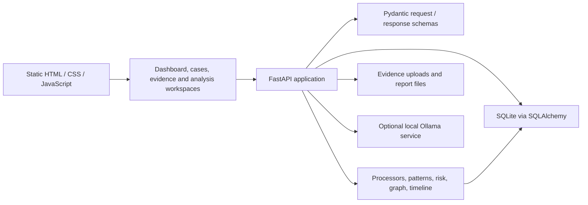

# CyberCore Technical Resource Library

> **Purpose:** An evidence-backed engineering handbook for the CyberCore repository: its runtime architecture, forensic data flow, APIs, setup, dependencies, and reuse boundaries. This document describes the checked-out implementation; it is not a claim of production readiness or forensic certification.
>
> **Last inspected:** 2026-11-17. Implementation descriptions are based on repository source and tests inspected on this date. The backend unit test suite passed (18 tests).

## Clickable table of contents

1. [Resource overview](#1-resource-overview)
2. [CyberCore architecture](#2-cybercore-architecture)
3. [Technology stack](#3-technology-stack)
4. [Frontend implementation library](#4-frontend-implementation-library)
5. [Backend implementation library](#5-backend-implementation-library)
6. [Python libraries and packages](#6-python-libraries-and-packages)
7. [API catalogue](#7-api-catalogue)
8. [Data architecture and persistence](#8-data-architecture-and-persistence)
9. [Evidence ingestion and processing](#9-evidence-ingestion-and-processing)
10. [Graph, timeline, and findings](#10-graph-timeline-and-findings)
11. [Risk scoring](#11-risk-scoring)
12. [Local Copilot and tool routing](#12-local-copilot-and-tool-routing)
13. [Reports and case lifecycle](#13-reports-and-case-lifecycle)
14. [Testing, debugging, and validation](#14-testing-debugging-and-validation)
15. [Known limitations and operational cautions](#15-known-limitations-and-operational-cautions)
16. [Reusable patterns for future projects](#16-reusable-patterns-for-future-projects)
17. [Setup and environment guide](#17-setup-and-environment-guide)
18. [Reference index](#18-reference-index)
19. [Reuse decision matrix](#19-reuse-decision-matrix)
20. [Maintenance and handoff](#20-maintenance-and-handoff)

## 1. Resource overview

CyberCore is a local-first cyber-fraud investigation workspace. Its backend stores cases and normalized transaction, device, email, and evidence records; deterministic processors derive findings, risk signals, timelines, graphs, and reports. A browser interface calls the local API, and an optional local Ollama model selects from a fixed allowlist of Copilot tools.

### Status vocabulary

- **IMPLEMENTED:** Source code and the API/UI surface exist in this checkout.
- **TESTED IN REPOSITORY:** A focused automated test exists for the named behavior. This label does not certify the complete workflow or this environment.
- **EXTERNAL RUNTIME:** Requires a separately installed service or executable, such as Ollama or the Tesseract OCR engine.
- **NOT ESTABLISHED:** The repository evidence reviewed does not establish deployment safety, forensic admissibility, accuracy on arbitrary evidence, or production readiness.

### Quick orientation

1. Start with the [architecture](#2-cybercore-architecture) and [API catalogue](#7-api-catalogue).
2. Follow an uploaded item through [evidence ingestion](#9-evidence-ingestion-and-processing) and into the [graph, timeline, and findings](#10-graph-timeline-and-findings).
3. Review the [known limitations](#15-known-limitations-and-operational-cautions) before using real evidence or exposing the service.
4. Use the [setup guide](#17-setup-and-environment-guide), then run the tests listed in [section 14](#14-testing-debugging-and-validation).
5. Treat output as investigative triage and analyst assistance, not as a determination of guilt or a substitute for validated forensic procedure.

### Scope boundaries

- **CyberCore-specific:** case lifecycle, evidence-kind vocabulary, CSV columns, risk rules, endpoint paths, storage paths, and Copilot tools.
- **Potentially reusable:** static browser UI with a JSON API, Pydantic validation, SQLAlchemy models, file hashing, deterministic graph construction, source-linked findings, and dependency-injected database sessions.
- **Not implied by this repository:** authentication, multi-user authorization, secure remote deployment, chain-of-custody certification, complete file-format parsing, or independently validated investigative conclusions.

## 2. CyberCore architecture

### Runtime boundary



The diagram reflects code-level connections. It does not represent a security boundary, distributed architecture, or guarantee that optional services are available.

### Main components

| Layer | Implementation | Evidence and status |
|---|---|---|
| Browser application | Static files in [`frontend/`](../frontend/) | HTML/CSS/JavaScript, no frontend build manifest in the checked-out tree |
| Browser-to-API | Native `fetch`; defaults to `http://127.0.0.1:8000` | `window.__API_BASE__` can override the base URL |
| API | FastAPI app in [`backend/app/main.py`](../backend/app/main.py) | Includes case, evidence, device, email, overview, transaction, analysis, risk, and report routers |
| Request and response validation | Pydantic v2 schemas in [`backend/app/schemas/`](../backend/app/schemas/) | Schema coverage varies by endpoint |
| Database | SQLite and SQLAlchemy in [`backend/app/database/`](../backend/app/database/) | Default database file is `backend/cybercore.db` |
| Evidence parsing | Pandas, Python document libraries, PDF reader, OCR adapter | Supported parsing is format- and schema-dependent |
| Forensic analysis | Modules in [`backend/app/forensic/`](../backend/app/forensic/) | Deterministic rules and NetworkX graph operations |
| Local language model | Ollama adapter in `slm.py` and tool router in `copilot.py` | Optional; selection failure uses deterministic fallback |
| Reports | JSON construction and ReportLab PDF generation | Generated under `backend/reports/` by the report route |

## 3. Technology stack

| Area | Technology | Role |
|---|---|---|
| Frontend | HTML, CSS, vanilla JavaScript | Static single-page workspaces and API calls |
| API | FastAPI, Uvicorn | HTTP routes, multipart upload handling, API documentation |
| Validation | Pydantic 2 | Request and response model validation |
| Persistence | SQLAlchemy 2, SQLite | Case and parsed evidence records |
| Tabular data | Pandas, NumPy, openpyxl | CSV, Excel, JSON normalization and parsing |
| Graph analysis | NetworkX | Transaction graphs, chain detection, unified evidence graph |
| Email parsing | Python standard library email utilities | EML headers and email addresses |
| Documents | `python-docx`, `pypdf` | DOCX text and PDF text extraction |
| OCR | `pytesseract`, Pillow | Image-to-text processing; requires an external Tesseract installation |
| PDF reports | ReportLab | PDF report rendering |
| Local SLM | Ollama HTTP API via `urllib` | Optional selection of an approved Copilot tool |
| Tests | Python `unittest` | Unit tests under `backend/tests/` |

Pinned Python dependencies are listed in [`backend/requirements.txt`](../backend/requirements.txt). The repository snapshot contains no frontend package manifest or frontend build/test runner.

## 4. Frontend implementation library

### Files and responsibilities

| File | Responsibility |
|---|---|
| [`frontend/index.html`](../frontend/index.html) | Static application shell, sidebar navigation, language switch, page/workspace markup |
| [`frontend/script.js`](../frontend/script.js) | English/Hindi strings, navigation, uploads, API requests, rendering, reports, Copilot |
| [`frontend/style.css`](../frontend/style.css) | Layout, navigation, panels, tables, responsive styling |

### Browser behavior

- Page navigation uses `data-page` attributes and JavaScript event handlers; it is not a server-rendered or React application.
- English and Hindi labels are held in a client-side translation object.
- The API base is `window.__API_BASE__ || "http://127.0.0.1:8000"`.
- The browser uploads files using `FormData` and routes `.eml` files to email ingestion, tabular device files to device ingestion when selected, and general evidence to the unified evidence endpoint.
- Graph, timeline, findings, entity dossier, Copilot, and report panels request their corresponding case-scoped API routes.

### UI/implementation mismatch to keep in sync

The upload helper text in the HTML advertises `CSV, JSON, TXT, EML, PDF`, while the backend unified evidence route additionally accepts Excel, DOCX, JPG, JPEG, and PNG. Update both the visible affordance and server-side validation together when changing file support; the backend currently has more accepted extensions than that hint advertises.

## 5. Backend implementation library

| Area | Source | Responsibility |
|---|---|---|
| App composition | [`backend/app/main.py`](../backend/app/main.py) | Creates tables, performs compatibility column additions, configures CORS, mounts routers, and provides `/` and `/health` |
| Models and database | [`backend/app/database/models.py`](../backend/app/database/models.py), [`database.py`](../backend/app/database/database.py) | Defines case, evidence, transaction, device, and email tables; creates the SQLite engine and request-scoped sessions |
| API routing | [`backend/app/api/routes/`](../backend/app/api/routes/) | Case, evidence, device, email, transaction, overview, risk, analysis, and report endpoints |
| Forensic processing | [`backend/app/forensic/`](../backend/app/forensic/) | Parsing, normalization, graph/pattern detection, risk, timelines, findings, brief, reports, and Copilot |
| Upload storage | [`backend/app/services/evidence_storage.py`](../backend/app/services/evidence_storage.py) | Persists uploaded source evidence |
| Transaction service | [`backend/app/services/transaction_service.py`](../backend/app/services/transaction_service.py) | Normalizes and validates uploaded transaction CSV data |
| Data contracts | [`backend/app/schemas/`](../backend/app/schemas/) | API request and response types |

### Startup behavior

On import, `main.py` calls `Base.metadata.create_all()` and applies additive compatibility migrations for selected case/evidence columns using SQL inspection and `ALTER TABLE`. This is a narrow in-code migration, not a general migration framework.

## 6. Python libraries and packages

The pinned dependency file is the installation source of truth. Important direct libraries by purpose:

| Package | Use in repository |
|---|---|
| `fastapi`, `uvicorn`, `python-multipart` | API server and multipart uploads |
| `sqlalchemy` | ORM, SQLite engine, sessions, relationships |
| `pydantic` | API request/response schemas and strict Copilot tool input |
| `pandas`, `numpy`, `openpyxl` | Tabular normalization and CSV/Excel ingestion |
| `networkx` | Directed transaction and unified evidence graphs |
| `python-docx`, `pypdf` | DOCX and PDF text extraction |
| `pytesseract`, `pillow` | Image OCR adapter |
| `reportlab` | PDF report output |
| `python-dotenv` | Environment-file support in the dependency set |

`pytesseract` is a Python wrapper. Install and configure the Tesseract executable separately if image OCR is needed. Ollama and its selected model are also external to `requirements.txt`.

## 7. API catalogue

All application routes are mounted by the FastAPI app. Interactive API documentation is normally available at `/docs` while the server is running.

| Method | Path | Purpose |
|---|---|---|
| `GET` | `/` | Basic backend-running response |
| `GET` | `/health` | Basic healthy response |
| `GET` | `/cases/` | List cases; also triggers cleanup of expired terminated cases |
| `POST` | `/cases/` | Create a case |
| `POST` | `/cases/{case_id}/terminate` | Terminate a case after a report has been generated |
| `DELETE` | `/cases/{case_id}` | Permanently delete a terminated case and stored evidence files |
| `POST` | `/cases/{case_id}/evidence` | Unified upload for accepted transaction, device, email, text/document, PDF, and image evidence |
| `GET` | `/cases/{case_id}/evidence` | List evidence metadata and download URLs |
| `GET` | `/cases/{case_id}/evidence/{evidence_id}/download` | Download a stored evidence file |
| `POST` | `/cases/{case_id}/transactions/upload` | Upload transaction CSV using the transaction schema |
| `GET` | `/cases/{case_id}/transactions` | List transaction rows |
| `POST` | `/cases/{case_id}/device-evidence` | Upload CSV/XLS/XLSX device records |
| `GET` | `/cases/{case_id}/device-correlation` | Find shared-device relationships |
| `POST` | `/cases/{case_id}/email-evidence` | Upload and parse an `.eml` artifact |
| `GET` | `/cases/{case_id}/email-findings` | Return email mismatch findings |
| `GET` | `/cases/{case_id}/analysis` | Transaction graph/pattern analysis and risk result |
| `GET` | `/cases/{case_id}/risk` | Risk score and signal breakdown |
| `GET` | `/cases/{case_id}/unified-graph` | Serialize financial, device, and email graph edges |
| `GET` | `/cases/{case_id}/timeline` | Return timestamped case events |
| `GET` | `/cases/{case_id}/findings` | Aggregate findings and risk information |
| `GET` | `/cases/{case_id}/brief` | Generate a compact case brief |
| `GET` | `/cases/{case_id}/entities/{entity_id}` | Return an entity dossier; the route captures entity IDs as a path value |
| `GET` | `/cases/{case_id}/copilot/tools` | Report Copilot mode/tool availability |
| `POST` | `/cases/{case_id}/copilot/ask` | Route a question to an allowlisted tool and return a grounded result |
| `GET` | `/cases/{case_id}/report` | Generate and persist forensic JSON and PDF artifacts |
| `GET` | `/cases/{case_id}/pdf-report` | Return the generated PDF report |

The canonical route implementations are under [`backend/app/api/routes/`](../backend/app/api/routes/). Consult those handlers and the schemas before depending on exact response fields or status codes; endpoint contracts may evolve.

## 8. Data architecture and persistence

### Core entities

| Table/model | Important fields | Role |
|---|---|---|
| `cases` / `Case` | `id`, `name`, `status`, `report_generated`, lifecycle timestamps | Investigation container |
| `evidence` / `Evidence` | `case_id`, `filename`, `sha256`, `kind`, `file_path`, `uploaded_at` | Source/report file metadata and integrity digest |
| `transactions` / `Transaction` | `transaction_id`, `sender`, `receiver`, `amount`, `timestamp` | Normalized financial events |
| `device_records` / `DeviceRecord` | `record_id`, `phone_number`, `imei`, `timestamp` | Device/CDR observations |
| `email_artifacts` / `EmailArtifact` | message ID, sender, recipient, reply-to, date header, source IP | Parsed EML header details |

Case relationships cascade when associated records are deleted. A case's report PDF/JSON are also persisted as evidence items after report generation.

### Storage locations

- SQLite database: `backend/cybercore.db` by default.
- Uploaded evidence: saved under the backend upload storage used by `evidence_storage.py`.
- Generated JSON and PDF reports: `backend/reports/`.
- Root-level `uploads/` and `reports/` folders are also present in the repository snapshot; do not assume they are the active backend paths without checking the runtime configuration and working directory.
- Local DB, upload, and report artifacts are excluded by `.gitignore` patterns.

The database URL is assembled from the backend package location, rather than an environment-configurable URL in the inspected database module.

## 9. Evidence ingestion and processing

### Unified evidence route

`POST /cases/{case_id}/evidence` performs the following high-level steps:

1. Confirms the case exists and is not terminated.
2. Checks the filename extension against the allowlist.
3. Reads the uploaded bytes, calculates SHA-256, and stores the original.
4. Selects an evidence processor: `.eml` is parsed as email; CSV/Excel/JSON is attempted as a transaction file and then as device data; other accepted formats use the transaction/text/OCR processing path.
5. Writes an `Evidence` row plus the normalized transaction, device, or email records.
6. Commits the database transaction and returns evidence metadata.

### Supported evidence paths

| Format | Processing path | Important behavior/requirements |
|---|---|---|
| CSV | Pandas table processing | Transaction columns: `transaction_id`, `sender`, `receiver`, `amount`, `timestamp`; device columns: `record_id`, `phone_number`, `imei`, `timestamp` |
| XLS/XLSX | Pandas Excel reader | Uses the same transaction or device schema; `openpyxl` is pinned for Excel support |
| JSON | JSON load into a DataFrame | Uses the same required transaction/device columns |
| TXT | Text extraction and row parser | Expects comma-separated transaction-like lines |
| DOCX | Paragraph text extraction, then row parser | Tables/header variants are not shown as handled by the inspected processor |
| PDF | Text layer extraction, then row parser | Scanned PDFs may require OCR or a separate preprocessing step |
| JPG/JPEG/PNG | OCR, then transaction parser | Requires a working external Tesseract installation |
| EML | Email header parser | Extracts headers such as sender, recipient, reply-to, date, message ID, and source IP |

The dedicated transaction CSV endpoint is narrower than unified ingestion: it requires `.csv` and supports compact column aliases `date` to `timestamp` and `upi_id` to `sender`; if `receiver` is absent it fills it with `UNKNOWN`.

### Evidence integrity notes

- SHA-256 is computed over the uploaded bytes and stored with the evidence metadata.
- Hashing identifies byte-level changes; it does not by itself prove acquisition provenance, custody, authenticity, or parser correctness.
- Extension checks and normalized schemas are not a full malware/content validation boundary.
- Some processing failures remove the newly written file and return a client error; review each route before assuming all error paths have identical cleanup/transaction guarantees.

## 10. Graph, timeline, and findings

### Transaction analysis

- `graph.py` builds the transaction graph consumed by transaction-chain analysis.
- `patterns.py` detects transaction chains and high-value transactions.
- `device_correlation.py` identifies shared device identifiers.
- `email_analysis.py` derives email-related findings, including sender/reply-to mismatch behavior.
- `findings.py` aggregates the separate finding groups for the overview/report surfaces.

### Unified graph model

[`unified_graph.py`](../backend/app/forensic/unified_graph.py) creates a NetworkX `MultiDiGraph` with evidence-kind-labelled edges:

- **Financial:** sender to receiver, with transaction ID, amount, and timestamp.
- **Device:** phone numbers sharing an IMEI connect to the IMEI hub when more than one phone is observed.
- **Email:** normalized sender to reply-to edge for relevant email findings.

The serializer emits plain `nodes`, `edges`, `total_nodes`, and `total_edges` fields. The graph is a correlation view; it does not establish that similarly named identifiers are the same real-world person.

### Timeline model

[`timeline.py`](../backend/app/forensic/timeline.py) combines transaction and device timestamps with parseable email date headers, labels each event by evidence type/source, and sorts chronologically. Email artifacts with absent or invalid date headers are omitted from the timeline.

## 11. Risk scoring

Risk behavior is implemented in [`risk.py`](../backend/app/forensic/risk.py):

- Maximum score and display denominator are both 10.
- The score starts at 1.
- One or more detected transaction chains add 2 points; three or more add another 2.
- One or more high-value transactions add 2 points; three or more add another 2.
- The score is capped at 10.
- Bands are `LOW` for scores through 3, `MEDIUM` through 6, and `HIGH` above 6.
- The high-value transaction threshold defaults to 20,000 and may be set through `CYBERCORE_HIGH_VALUE_THRESHOLD`.

The current assessment uses the original count-based chain/high-value rule. Although it accepts additional evidence arguments and has helper routines for rapid routing, fan-out, and cross-evidence references, those do not currently alter the returned score in `calculate_risk_assessment`. Treat the numeric score as a narrow heuristic, not a validated probability, severity measure, or legal conclusion.

Focused risk tests are in [`backend/tests/test_risk.py`](../backend/tests/test_risk.py).

## 12. Local Copilot and tool routing

### Architecture

The local model is used to choose a tool, not to execute arbitrary code or directly produce the evidence result:

1. [`slm.py`](../backend/app/forensic/slm.py) sends a constrained JSON tool-selection prompt to the Ollama `/api/chat` endpoint.
2. Pydantic `ToolSelection` validates the selected tool against a literal allowlist.
3. [`copilot.py`](../backend/app/forensic/copilot.py) validates arguments and executes the corresponding deterministic, case-data-backed function.
4. The response includes the selected tool, arguments, result, mode, grounded data, and limitations.
5. If the SLM is disabled, unavailable, times out, or returns invalid output, the router uses a deterministic question-to-tool fallback; unsupported questions can return a limitation instead of an invented result.

### Allowlisted tools

`find_entity`, `get_transactions`, `get_connected_entities`, `get_fund_paths`, `get_risk_findings`, `get_timeline`, `generate_case_brief`, and `get_email_findings`.

The Copilot schemas reject extra fields in tool arguments. A test verifies that an unapproved `run_sql` tool is rejected and that fallback results remain grounded in supplied case data.

### Configuration

| Variable | Default | Purpose |
|---|---|---|
| `CYBERCORE_SLM_ENABLED` | `true` | Enables the Ollama selection attempt; set to `false` to force deterministic fallback |
| `CYBERCORE_SLM_MODEL` | `qwen3.5:9b-q4_K_M` | Model name sent to Ollama |
| `OLLAMA_BASE_URL` | `http://localhost:11434` | Ollama service base URL |
| `CYBERCORE_SLM_TIMEOUT_SECONDS` | `60` | HTTP request timeout |

Model correctness, hardware requirements, and answers beyond supported deterministic tools are not certified by repository tests.

## 13. Reports and case lifecycle

### Report generation

`GET /cases/{case_id}/report` assembles case metadata, evidence hashes, summary counts, risk, timeline, findings, entities, graph, and pattern results. It writes:

- `backend/reports/case_<id>_forensic_report.json`
- `backend/reports/case_<id>_forensic_report.pdf`

The files are also represented as evidence entries with SHA-256 hashes. Generating the report sets `report_generated = true`.

### Termination and deletion

- Termination is allowed only after a report has been generated.
- A terminated case receives a deletion timestamp 30 days later.
- Explicit deletion is limited to terminated cases and removes associated stored evidence files before deleting the case record.
- Expired-case cleanup runs when `GET /cases/` is called; the inspected code does not show a scheduled background cleanup process.
- Report filenames are based on case IDs and are rewritten when the report for that case is regenerated.

## 14. Testing, debugging, and validation

### Existing tests

| File | Coverage visible in source |
|---|---|
| [`backend/tests/test_copilot.py`](../backend/tests/test_copilot.py) | Tool validation, allowlisting, fallback on SLM errors, grounded risk responses, unsupported questions |
| [`backend/tests/test_email_and_graph.py`](../backend/tests/test_email_and_graph.py) | UTF-8 BOM EML parsing, source IP extraction, sender/reply-to graph edge |
| [`backend/tests/test_risk.py`](../backend/tests/test_risk.py) | Legacy score increments, cap/bands, score breakdown, empty-signal baseline |

### Run the tests

From the `backend` directory, after installing [`requirements.txt`](../backend/requirements.txt):

```powershell
python -m unittest discover -s tests -v
```

This command is based on the checked-in `unittest` test modules. It was not run while writing this resource document.

### Useful manual checks

1. Start the API and verify `GET /health`.
2. Open `/docs` to inspect the active route contracts.
3. Create a disposable case and exercise upload, findings, timeline, graph, report, and deletion in that order.
4. For Copilot without Ollama, set `CYBERCORE_SLM_ENABLED=false` and check that supported questions use deterministic fallback.
5. Use temporary evidence and a disposable database when testing; the app's default database and storage locations are persistent local files.

## 15. Known limitations and operational cautions

- **No authentication or authorization is visible in the application code.** Do not expose the API or frontend to an untrusted network without adding and validating an access-control boundary.
- **CORS allows all origins.** `main.py` configures `allow_origins=["*"]`; this is permissive and should be reviewed before deployment.
- **Static frontend advertises fewer file types than the backend accepts.** Keep UI affordances and route validation aligned.
- **Parsers are schema-specific.** Arbitrary spreadsheets, nested JSON, complex PDFs, scanned documents, or unusual encodings may not normalize correctly.
- **OCR depends on an external binary.** Installing the Python package alone does not establish that OCR will work on a machine.
- **Risk is a count-based heuristic.** It is not trained, calibrated, or established as a measure of real-world fraud likelihood.
- **Hashing alone is not chain of custody.** Acquisition logs, immutable storage, access controls, validated clocks, and reproducible processing are not established by the SHA-256 field.
- **SQLite and local file storage are single-host defaults.** Concurrent users, backups, retention guarantees, and multi-tenant isolation are not established.
- **In-code schema updates are limited.** Use a proper migration strategy before changing persistent production schemas.
- **Local LLM outputs require scrutiny.** The allowlist and deterministic execution constrain tool access, but they do not validate the model's tool choice as analytically correct.

## 16. Reusable patterns for future projects

### Good candidates to reuse

- Keep API request/response contracts in explicit Pydantic schemas.
- Normalize uploaded records into a small canonical shape before analysis.
- Store source evidence metadata separately from parsed operational records.
- Compute a digest of uploaded bytes and preserve it alongside the original file.
- Use an explicit evidence-kind tag on graph edges and timeline events.
- Make AI select from a closed tool set and run the actual operation in deterministic application code.
- Return structured limitations and source references along with summaries.
- Exercise failure and fallback behavior with mocks rather than requiring a live model in every test.

### Reuse with adaptation

- The current models and rule thresholds are case-study-specific; do not copy their names, schema or amounts unchanged.
- Review upload size limits, content validation, filename handling, transactional cleanup and storage isolation for the target threat model.
- Replace count-based risk rules with domain-validated, explainable logic and tests before making consequential use of scores.
- Add migrations and configurable storage/database backends if the target needs upgrades, multiple users, or deployment portability.

## 17. Setup and environment guide

### Backend

Run these commands in PowerShell from the repository root:

```powershell
Set-Location .\backend
python -m venv .venv
.\.venv\Scripts\Activate.ps1
python -m pip install -r requirements.txt
uvicorn app.main:app --reload
```

The API listens on the Uvicorn default `http://127.0.0.1:8000`; browse `/docs` or `/health` to check it. If PowerShell blocks activation, use the Python executable inside `.venv\Scripts\` directly instead of changing machine-wide execution policy.

### Frontend

Serve [`frontend/index.html`](../frontend/index.html) with a static-file server or open it locally. The frontend defaults to `http://127.0.0.1:8000`; set `window.__API_BASE__` before using the app when a different backend URL is intentional. The backend CORS settings currently allow the static frontend's origin.

### Optional local Copilot

Start Ollama and install the configured model separately:

```powershell
ollama serve
ollama pull qwen3.5:9b-q4_K_M
```

To use the deterministic offline route instead:

```powershell
$env:CYBERCORE_SLM_ENABLED = "false"
```

Other settings and defaults are listed in [section 12](#12-local-copilot-and-tool-routing). Image OCR additionally needs a separately installed Tesseract executable.

## 18. Reference index

### Project files

- [README](../README.md)
- [Backend requirements](../backend/requirements.txt)
- [FastAPI app and router wiring](../backend/app/main.py)
- [Database models](../backend/app/database/models.py)
- [Forensic processing modules](../backend/app/forensic/)
- [API routes](../backend/app/api/routes/)
- [Schemas](../backend/app/schemas/)
- [Frontend](../frontend/)
- [Tests](../backend/tests/)

### External runtime documentation

- [FastAPI documentation](https://fastapi.tiangolo.com/)
- [SQLAlchemy documentation](https://docs.sqlalchemy.org/)
- [Pydantic documentation](https://docs.pydantic.dev/)
- [NetworkX documentation](https://networkx.org/documentation/stable/)
- [Ollama API documentation](https://docs.ollama.com/api)
- [Tesseract OCR documentation](https://tesseract-ocr.github.io/)
- [ReportLab documentation](https://docs.reportlab.com/)

External links are vendor/project references, not evidence that every linked capability has been configured or verified in this checkout.

## 19. Reuse decision matrix

| Component | Reuse decision | Before reuse |
|---|---|---|
| Static UI/API separation | Reuse the pattern | Define stable API contracts and error/loading states |
| Case/evidence relational model | Adapt | Add ownership, access control, migrations, and retention policy |
| File SHA-256 metadata | Reuse with caution | Add documented acquisition, custody, and storage controls |
| Transaction/device normalizers | Adapt | Validate against target source formats and locale/timezone conventions |
| Unified graph and timeline | Adapt | Preserve provenance and distinguish observed facts from inferred links |
| Current risk score | Do not reuse as-is for consequential decisions | Validate rules with domain experts and representative data |
| Local Copilot tool router | Reuse the allowlist pattern | Review tool permissions, inputs, outputs, logging, and model behavior |
| Local SQLite/file persistence | Suitable for local prototypes | Add backups, access isolation, migrations, and operational monitoring |
| Report generation | Adapt | Validate every claim, trace fields to source evidence, and review privacy |

## 20. Maintenance and handoff

For changes affecting this handbook:

1. Update the relevant section when the runtime, API, data model, dependencies, setup, tests, or limitations change.
2. Verify route paths from the mounted FastAPI routers, not only from frontend labels.
3. Separate implemented behavior from planned work and from externally supplied capabilities.
4. Record which tests were actually run and their observed result; do not describe an unrun test as passing.
5. Review upload types, data retention, default configuration, and security boundaries before exposing a new deployment.

This resource library is a navigation and reuse aid. Source code, schemas, executable tests, and the actual runtime remain authoritative if they disagree with this document.
